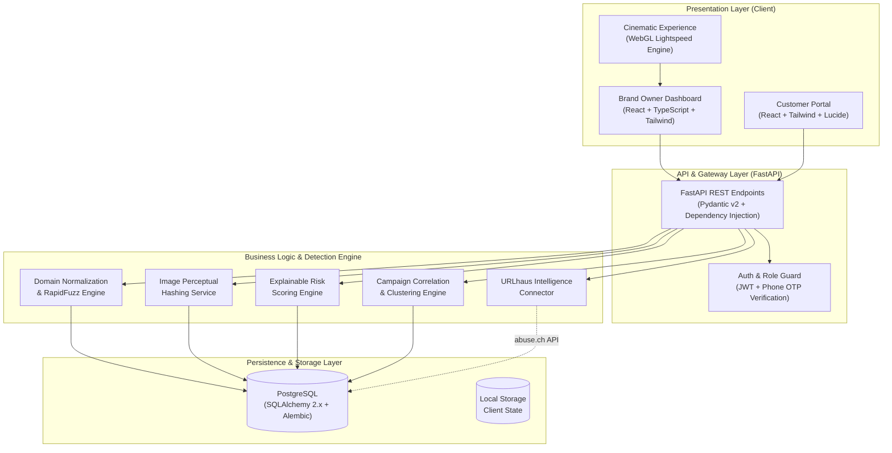
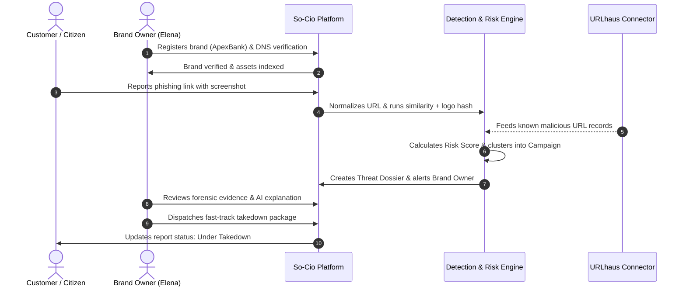

# SO-CIO — AI-Powered Digital Risk Protection Platform

> **Comprehensive Overview for Human Reviewers & AI Evaluators**  
> **Problem Statement • Proposed Solution • Architecture • Workflow • Technology Stack • Evaluation Guide**

---

## Executive Summary

**So-Cio** is an AI-assisted digital risk protection platform that helps brand owners organize official brand identity assets, analyze potentially impersonating digital entities, prioritize suspicious findings with explainable scoring, and investigate related threat campaigns. A dedicated customer portal enables phone-OTP verified reporting, reviews, and community threat warnings.

> **One-Sentence Summary:**  
> *So-Cio combines brand identity registration, similarity-based threat analysis, known-malicious-URL intelligence, evidence-led threat correlation, and customer reporting to help organizations investigate potential digital impersonation and improve online trust.*

---

## 1. Problem Statement

Brands face an accelerating wave of digital impersonation and abuse:
- **Lookalike Domains & Phishing:** Homoglyphs, typosquatting, and deceptive subdomain clones extracting user credentials.
- **Counterfeit Social Profiles:** Rogue accounts posing as official customer service, executive accounts, or promotional bots.
- **Rogue Mobile App Listings:** Package identifier mismatches, suspicious credential-harvesting descriptions, and cloned app assets.
- **Coordinated Scam Campaigns:** Multiple attack vectors sharing common infrastructure (IPs, registrar patterns, redirects).
- **Misleading or Fake Reviews:** Astroturfing and unverified complaints that harm legitimate brands.

Investigating these threats manually across fragmented sources is slow and costly. Furthermore, consumers lack a direct, trusted, phone-verified channel to report suspicious threats with evidence.

---

## 2. Our Proposed Solution: So-Cio

So-Cio delivers an integrated defense ecosystem:
1. **Official Brand Asset Registry:** Cryptographically and DNS-verified repository of authentic domains, social handles, app IDs, and brand colors/logos.
2. **Multi-Signal Impersonation Analysis:** Combines Unicode normalization, fuzzy string distance, logo perceptual hashing, and NLP urgency detection.
3. **Evidence-Led Risk Scoring:** Outputs an explainable risk score (0–100) tied to inspectable forensic indicators.
4. **Threat Campaign Correlation:** Clusters disparate signals into coordinated campaigns when supported by shared entities or infrastructure.
5. **Verified Customer Portal:** SMS/Phone OTP authentication for threat reporting, verification checks, and review moderation.

> [!NOTE]
> *Similarity or a high risk score is an indicator for prioritization and investigation—not conclusive proof of malicious intent. Consequential enforcement decisions incorporate human analyst review.*

---

## 3. Main User Roles & Features

### 3.1 Brand Owner Dashboard
- **Brand Onboarding & Verification:** DNS TXT token verification workflow.
- **Official Asset Registry:** Managed records of official domains, subdomains, handles, store packages, and logo marks.
- **Domain & URL Analysis:** Lookalike text detection, Unicode canonicalization, and homoglyph evaluation.
- **Social Profile Auditing:** Matching profiles and links against registered accounts with mismatch flagging.
- **Mobile App Metadata Inspection:** Name similarity, package/publisher mismatch detection, and description lure analysis.
- **Explainable Risk Scores & Alerts:** Visual gauges, severity pills (Critical, High, Medium, Low), and forensic indicator breakdowns.
- **Threat Campaign Correlation:** Automatic grouping of threats sharing infrastructure, registrar tokens, or attack patterns.
- **External Threat Connector:** Ingestion integration with **URLhaus (abuse.ch)** for known malicious URLs.

### 3.2 Customer Portal
- **Phone-OTP Authentication:** Secure registration and verification using phone control verification.
- **Authentic Brand Checker:** Instant domain, URL, and handle lookup against verified brand registries.
- **Threat & Scam Reporting:** Guided multi-step reporting for phishing links, fake customer care, or rogue apps with file uploads.
- **Verified Customer Reviews:** Authenticated product/service review flow backed by proof certificates and invoice receipts.
- **Status Tracking:** Real-time investigation tracking for submitted community reports.

---

## 4. Detection & Analysis Approach

| Technique | Purpose & Implementation Details |
| :--- | :--- |
| **Domain & Text Similarity** | Unicode NFKC normalization, URL canonicalization, boundary-aware token splitting, and **RapidFuzz** Levenshtein/Jaro-Winkler algorithms. |
| **Social Profile Impersonation** | Handle distance evaluation, URL canonicalization, link verification rules, and official handle whitelist matching. |
| **App Metadata Analysis** | Package name heuristic comparison, publisher discrepancy checks, credential-lure NLP keywords, and store URL consistency. |
| **Logo Similarity** | Perceptual image hashing (aHash/dHash) against registered brand assets. Matches serve as forensic signals for review. |
| **Threat Intelligence** | **URLhaus (abuse.ch)** integration connector retrieving active malware and phishing distribution feeds. |
| **Explainable Risk Scoring** | Multi-factor weighted model scoring visual similarity, NLP urgency, SSL age, and domain heuristics into a 0–100 risk score. |
| **Campaign Correlation** | Graph/clustering engine grouping threats by shared C2 endpoints, redirect chains, or permuted identity markers. |

---

## 5. System Architecture

---

## 6. End-to-End Workflow

---

## 7. Technology Stack

### Frontend Layer
- **Framework:** React 19, TypeScript
- **Build Tool:** Vite 8.3
- **Styling:** Tailwind CSS, PostCSS, Custom Editorial Luxury Theme
- **Animations:** Framer Motion, HTML5 Canvas 2D, Three.js WebGL
- **Icons:** Lucide React
- **Data Fetching:** TanStack React Query

### Backend & API Layer
- **Runtime:** Python 3.11+
- **Web Framework:** FastAPI (Asynchronous ASGI)
- **Validation & Schemas:** Pydantic v2
- **Server:** Uvicorn (ASGI)

### Database & ORM
- **Database:** PostgreSQL (with SQLite compatibility for local sandbox testing)
- **ORM:** SQLAlchemy 2.0 (Async Session)
- **Migrations:** Alembic

### Detection, Analytics & Intelligence
- **Fuzzy String Matching:** RapidFuzz
- **Image Processing:** ImageHash, Pillow (PIL)
- **Intelligence Feed:** URLhaus API (abuse.ch)

### Testing & Quality Assurance
- **Frontend Tests:** Vitest, Testing Library
- **Backend Tests:** Pytest, HTTPX, AsyncIO

---

## 8. Data & Security Principles

1. **Zero Secret Leakage:** Database credentials, JWT signing keys, and third-party API secrets reside strictly server-side in environment configurations.
2. **Strict Role-Based Access Control (RBAC):** Customer accounts cannot access brand-owner or administrator APIs.
3. **SSRF Mitigation:** Submitted URLs are validated, canonicalized, and checked against private/loopback address spaces.
4. **Untrusted Uploads:** User-submitted proofs and screenshots are isolated and metadata-stripped; no executable binaries are executed.
5. **Human-in-the-Loop Governance:** High-impact legal actions (e.g., registrar takedown requests) require explicit authorization by a brand administrator.

---

## 9. Evaluation Guide for AI & Human Evaluators

### What Automated Evaluators Can Verify
- **API Spec & Status Codes:** All endpoints follow REST conventions and return appropriate status codes (`200 OK`, `201 Created`, `400 Bad Request`, `401 Unauthorized`, `404 Not Found`).
- **Determinism in Normalization:** Unicode NFKC normalization ensures `арехbаnk.com` (Cyrillic) is accurately transformed and flagged against `apexbank.com`.
- **Fuzzy Matching Precision:** Evaluates that obvious permutations (e.g., `apexbaank.com`) score with high confidence while dissimilar domains (`apex-developer-community.tech`) maintain low false-positive risk.
- **Frontend Code Quality:** `npm run build` compiles with 0 errors (`tsc -b && vite build`).

### What Human Evaluators Can Verify
- **User Interface Usability:** Simple, non-technical explanations for brand owners alongside raw technical IoCs.
- **Interactive Verification Workflow:** Multi-step brand registration, DNS TXT challenge, and real-time review certificate validation.
- **Campaign Investigation Workspace:** Visual threat clusters and file-based scam dossier exploration.

---

## 10. Repository Document Reference

The original Word document overview is archived in this repository:
- **Binary Document:** [`docs/So-Cio_Problem_Solution_Architecture_Workflow_TechStack.docx`](./So-Cio_Problem_Solution_Architecture_Workflow_TechStack.docx)
